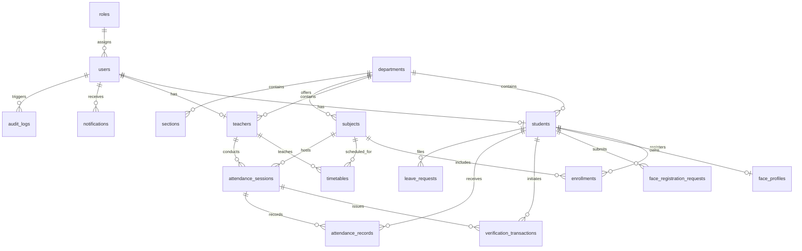

# SmartPresence — Architecture, Database ER Diagram, ML Pipeline & Security

## 1. End-to-End Verification Pipeline
```
Teacher Auth (JWT + Argon2id)
   ↓
Attendance Session Creation (Manual or Automatic Timetable Window, Server UTC)
   ↓
HMAC-SHA256 Dynamic QR Generation (CSPRNG Nonce + Redis/TTL Store, 5–10s Rotation)
   ↓
Cross-Device QR Scan (Web html5-qrcode / Native Google ML Kit)
   ↓
Backend QR, Session Window & Enrollment Validation -> VerificationTransaction (150s TTL)
   ↓
Front Camera Activation (Rear stream released prior to front camera start)
   ↓
BlazeFace (Single-Face Guard) -> MediaPipe FaceLandmarker (478 Landmarks)
   ↓
EAR + MAR + SolvePnP (Head Pose) + Static-Replay Motion Check
   ↓
MiniFASNetV2 (Passive Anti-Spoofing) + Randomized Active Challenge-Response
   ↓
RetinaFace / SCRFD-10G (5 Landmarks) -> 112x112 Affine Alignment -> ArcFace ResNet-100 (512-D)
   ↓
1:1 Cosine Similarity vs Authority-Approved AES-256-GCM Encrypted FaceProfile
   ↓
Server-Side Rule-Based Decision Engine -> Atomic PostgreSQL AttendanceRecord (Unique Session+Student)
   ↓
JWT-Protected WebSocket Broadcast -> Live Teacher Roster & Analytics Update
```

## 2. Database Entity-Relationship Diagram (19 Tables)


## 3. Platform Feature Matrix (Browser vs PWA vs Android vs iOS)
| Capability | Desktop / Mobile Browser | Installed PWA | Native Android (Flutter) | Native iOS (Flutter) |
|---|---|---|---|---|
| Login, Dashboards & Reports | Full | Full | Full | Full |
| Dynamic QR & WebSocket Monitor | Full | Full | Full | Full |
| Camera QR Scan (`getUserMedia` / ML Kit) | HTTPS / `localhost` | HTTPS | Google ML Kit | Apple Vision / ML Kit |
| Offline App Shell & Installable Icon | Static only | **Yes (`sw.js` + `manifest.json`)** | Native | Native |
| Offline Attendance Marking | **Blocked by Policy** | **Blocked by Policy** | **Blocked by Policy** | **Blocked by Policy** |
| Screenshot / Capture Blocking | **Cannot block OS/external cameras** (Projection Mode disables copy) | Same as browser | **`FLAG_SECURE` via MethodChannel** | Screen capture detection supported |

## 4. Security & Privacy Controls
- **Passwords:** Argon2id (`memory_cost=65536`, `time_cost=3`, `parallelism=4`).
- **Tokens:** Short-lived JWT access tokens + rotating refresh tokens with JTI revocation.
- **Biometrics:** AES-256-GCM encrypted embeddings and encrypted authority review previews stored in PostgreSQL; raw video is never recorded or stored, and `localStorage` never stores biometrics or QR secrets.
- **QR Protection & Honest Scope:** Rotating HMAC-SHA256 nonces (5–10s) mitigate screenshot sharing, while browser projection cannot stop an external camera photographing a screen; BLE/geofencing would be an additional proximity layer if required.
- **Anti-Spoofing Limitations:** MiniFASNetV2 + temporal EAR/MAR/SolvePnP challenges + inter-frame motion guards reject static photos and standard screen replays, though no vision model guarantees 100% immunity against sophisticated real-time deepfakes or virtual camera injection.
